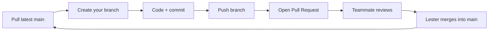

# Git Guide: Working on Your Own Branch

**Golden rule: never commit directly to `main`.** You always work on your own branch, then ask to merge it through a Pull Request (PR). That way `main` always works for everyone.



You can use the terminal (commands below) or **GitHub Desktop** / the **VS Code Source Control** panel. The steps are the same.

---

## 0. One-time setup

```bash
git config --global user.name "Your Name"
git config --global user.email "your-github-email@example.com"

cd C:\xampp\htdocs
git clone <repo-url> IT-Helpdesk-DBA-Final-Project
cd IT-Helpdesk-DBA-Final-Project
```

## 1. Start a task: get the latest `main`

Always do this **before** creating a new branch:

```bash
git checkout main
git pull
```

## 2. Create your branch

```bash
git checkout -b feature/equipment-list
```

Branch naming: `type/area-thing`

| Type | Use for | Example |
|---|---|---|
| `feature/` | new page or function | `feature/tickets-create` |
| `fix/` | fixing a bug | `fix/login-error-message` |
| `db/` | SQL changes | `db/add-security-user` |
| `docs/` | documentation | `docs/backup-guide` |

Check which branch you're on at any time:
```bash
git branch        # the one with * is your current branch
git status
```

## 3. Work and commit

Commit small pieces of work often:

```bash
git status                       # see what changed
git add equipment/index.php      # stage specific files (preferred)
git commit -m "equipment: add list table with status badges"
```

Commit message format: `area: what you did`
- `tickets: add create form validation`
- `ui: highlight active navbar link`

Avoid `git add .` unless you've checked `git status`. You don't want to commit `config/db.php` or random files.

## 4. Push your branch to GitHub

The first time:
```bash
git push -u origin feature/equipment-list
```
After that, just:
```bash
git push
```

## 5. Open a Pull Request

1. Go to the repo on GitHub. A yellow banner shows **"Compare & pull request"**. Click it.
2. Base: `main` ← compare: `feature/equipment-list`
3. Fill in the PR template (what changed, how to test). Write `Closes #<issue number>`.
4. Add a teammate as **Reviewer**.

## 6. Review and merge

- The reviewer pulls your branch, tests it, and approves or comments.
  ```bash
  git fetch
  git checkout feature/equipment-list
  ```
- If changes are requested: fix them on the **same branch**, commit, `git push`. The PR updates automatically.
- **Lester merges** approved PRs into `main`.

## 7. After your PR is merged

```bash
git checkout main
git pull
git branch -d feature/equipment-list   # delete the old local branch
```
Then go back to step 2 for your next task.

---

## Keeping your branch up to date

If `main` changed while you were working (others merged PRs), bring those changes into your branch:

```bash
git checkout main
git pull
git checkout feature/equipment-list
git merge main
```

Do this at least every few days, and always before opening a PR.

## Merge conflicts

If `git merge main` says **CONFLICT**:

1. Open the file. You'll see:
   ```
   <<<<<<< HEAD
   your version
   =======
   the version from main
   >>>>>>> main
   ```
2. Edit it to the correct final code and delete the `<<<<<<<`, `=======`, `>>>>>>>` lines. VS Code has "Accept Current / Incoming / Both" buttons.
3. Save, then:
   ```bash
   git add <file>
   git commit
   ```
4. If you're unsure, **stop and ask in the group chat**. `git merge --abort` undoes the merge attempt safely.

## "Oops" fixes

| Problem | Fix |
|---|---|
| I made changes on `main` by accident (not committed yet) | `git checkout -b feature/my-branch` (your changes move with you) |
| I committed on `main` by accident (not pushed) | `git branch feature/my-branch` → `git reset --hard origin/main` → `git checkout feature/my-branch` |
| I want to throw away changes to one file | `git restore path/to/file.php` |
| I need to switch branches but have unfinished work | `git stash` → switch → later `git stash pop` |
| Changed the database schema? | Re-import `database/01_schema.sql` then `02_seed.sql` in phpMyAdmin |

## Rules recap
1. Never push to `main`.
2. One branch per task/issue.
3. Pull `main` before starting, and merge `main` into your branch before opening a PR.
4. Only edit files you own. If you need to touch someone else's file, tell them first.
5. Never commit `config/db.php`.

