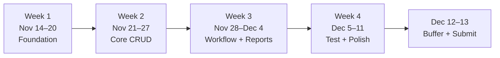

# Roadmap (4 weeks)

Start: **Sat Nov 14, 2026** · Code freeze: **Fri Dec 11** · Deadline: **~Sun Dec 13** (2-day buffer)

## Week 1: Foundation (Nov 14–20)
**Goal:** everyone can run the app locally and log in.

- [ ] Everyone: install XAMPP, clone, import SQL, open the site (**by Nov 15**)
- [ ] DB: review `01_schema.sql` against the paper, test trigger + view in phpMyAdmin
- [ ] Auth: working login/logout, `attempt_login()`, role redirects
- [ ] UI: navbar and layout finalized, dashboard skeleton per role
- [ ] Each owner: read your stub files, ask questions early

**Milestone M1:** all 3 roles can log in and see their own navbar.

## Week 2: Core CRUD (Nov 21–27)
**Goal:** all read/create screens work.

- [ ] Tickets: list (filtered by role), create, detail view with timeline
- [ ] Equipment: list, create/edit, detail
- [ ] Users: list, create/edit, activate/deactivate; departments page
- [ ] Skills: technician skills page
- [ ] DB: R1–R5 queries verified with seed data, screenshots for paper

**Milestone M2:** an employee can file a ticket and an admin can see it.

## Week 3: Workflow + Reports (Nov 28–Dec 4)
**Goal:** business rules BR16–BR19 enforced, reports done.

- [ ] Tickets: comments, status changes (BR16, BR18), assignment (BR17)
- [ ] Equipment: retired rules (BR19)
- [ ] Reports page (SLA, workload, recurring, slow tickets)
- [ ] Dashboards filled with real numbers
- [ ] DB (optional DBA extras): limited-privilege app user, backup/restore script

**Milestone M3:** feature complete. Full ticket life cycle works end to end.

## Week 4: Test + Polish (Dec 5–11)
- [ ] Everyone tests someone else's module using [PAGES.md](PAGES.md) as a checklist
- [ ] Try to break the rules (reopen a resolved ticket, assign an unqualified tech, etc.)
- [ ] UI consistency pass (badges, spacing, empty states)
- [ ] Screenshots + system chapter for the paper
- [ ] Demo script and rehearsal

**Milestone M4 (Dec 11):** code freeze, tag `v1.0`.

## Weekly rhythm
- **Monday:** 15-min sync (what's done, what's blocked)
- **Thursday:** PRs for the week should be open
- **Sunday:** lead merges, everyone pulls `main`

